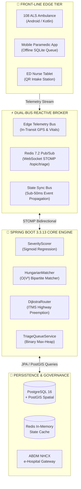

<div align="center">


# TriageNet

### Statewide Algorithmic Golden-Hour Clinical Operating System & Emergency Logistics Platform
**Modeled for the 24 Districts & 79 Healthcare Facilities of Jharkhand, India**

<p align="center">
  <a href="https://github.com/PG300604/TriageNet/releases/tag/v1.3.0"></a>
  <a href="https://triagenet-frontend.onrender.com"></a>
  <a href="https://github.com/PG300604/TriageNet/actions/workflows/ci.yml"></a>
  <a href="https://spring.io/projects/spring-boot"></a>
  <a href="https://nextjs.org/"></a>
  <a href="https://www.postgresql.org/"></a>
  <a href="https://redis.io/"></a>
  <a href=".github/LICENSE"></a>
</p>

<p align="center">
  <a href="https://triagenet-frontend.onrender.com"><strong>🚀 Launch Live Cloud Demo (Guest Sandbox)</strong></a> •
  <a href="https://github.com/PG300604/TriageNet/releases/tag/v1.3.0"><strong>📦 Download v1.3.0 Release Packages</strong></a> •
  <a href="https://triagenet-frontend.onrender.com/portal"><strong>🏥 Citizen Emergency Portal</strong></a> •
  <a href="https://triagenet-backend.onrender.com/api/swagger-ui.html"><strong>📖 OpenAPI 3.0 Contract</strong></a>
</p>

---

### 🎬 Master Explainer Video (112s Silent Tech Keynote)
*Synced to the high-energy soundtrack "Rise Up" by Aylex — Built with Glassmorphism, 60 FPS Chromium motion graphics, and Manim.*

[](https://github.com/PG300604/TriageNet/releases/tag/v1.3.0)

<p align="center">
  <em>👆 <strong>Click the banner to watch or download the full 112s high-production video</strong> (1080p @ 60 FPS, 24.5 MB).</em>
</p>

</div>

---

## 📑 Table of Contents
- [Executive Overview](#-executive-overview)
- [Live Cloud Deployments & Guest Sandbox](#-live-cloud-deployments--guest-sandbox)
- [The Golden Hour Dilemma](#-the-golden-hour-dilemma)
- [4 Hand-Implemented Clinical Algorithms](#-4-hand-implemented-clinical-algorithms)
  - [1. SeverityScorer (Sigmoid Acuity Regression)](#1-severityscorer--sigmoid-acuity-logistic-regression)
  - [2. HungarianMatcher (Optimal Bipartite Allocation)](#2-hungarianmatcher--optimal-bipartite-specialist-allocation)
  - [3. DijkstraRouter & 108 Green Wave ITMS](#3-dijkstrarouter--highway-congestion--108-green-wave)
  - [4. TriagePriorityQueue (Max-Heap Bed Allocator)](#4-triagepriorityqueue--sub-millisecond-bed-allocation)
- [System Architecture & Reactive Data Flow](#-system-architecture--reactive-data-flow)
- [Statewide 3D GIS Command Console](#-statewide-3d-gis-command-console)
- [Mobile 108 Companion App Suite](#-mobile-108-companion-app-suite)
- [6-Role RBAC Governance & Security Matrix](#-6-role-rbac-governance--security-matrix)
- [State Healthcare Financial Governance (₹ INR)](#-state-healthcare-financial-governance--inr)
- [Measurable Statewide Clinical Impact](#-measurable-statewide-clinical-impact)
- [Complete Technology Stack & Tool Taxonomy](#-complete-technology-stack--tool-taxonomy)
- [Quickstart & Deployment Guide](#-quickstart--deployment-guide)
- [Official Release Packages & Verification](#-official-release-packages--verification)
- [Contributing & License](#-contributing--license)

---

## 🌟 Executive Overview

**TriageNet** is an autonomous, statewide emergency healthcare resource coordination platform engineered to eliminate preventable trauma deaths during the critical **60-Minute Golden Hour**. 

Connecting **79 hospitals across all 24 districts of Jharkhand** (*Apex Tertiary Centers like RIMS Ranchi, MGM Jamshedpur, Sadar District Hospitals, and Sub-Divisional CHCs*), TriageNet synchronizes frontline 108 ambulance paramedics, emergency department triage nurses, on-duty trauma surgeons, and state health leadership into a single, unified, sub-50 millisecond reactive operating system.

### Key Architectural Pillars
- **Zero Black-Box Dependencies**: All 4 clinical decision and spatial algorithms are hand-crafted from mathematical first principles in Java 17 and Python.
- **Dual-Bus Reactive Pipeline**: Real-time GPS vitals streaming from 108 ambulances to receiving trauma bays via Redis 7.2 Pub/Sub and WebSocket STOMP.
- **Municipal ITMS Green Wave Preemption**: Highway traffic signal preemption along critical transit corridors (NH-33, GT Road, NH-20).
- **Dual-Control Verification & Sovereign Governance**: Glove-friendly FIDO2 WebAuthn authentication, Ayushman Bharat ABDM integration, and NIC e-Hospital claim reconciliation.

---

## 🌐 Live Cloud Deployments & Guest Sandbox

TriageNet is officially deployed and operational on cloud infrastructure:

| Endpoint | Service | Purpose |
| :--- | :--- | :--- |
| **[Web Console](https://triagenet-frontend.onrender.com)** | Next.js 16 Production Frontend | Statewide 3D GIS Command Center & Clinical Workstations |
| **[Backend API](https://triagenet-backend.onrender.com/api)** | Spring Boot 3.3.13 Runtime | Managed REST API, STOMP WebSockets, Algorithmic Services |
| **[Citizen Portal](https://triagenet-frontend.onrender.com/portal)** | Public Emergency Gateway | 24-District helplines, hospital availability, emergency guides |
| **[Mobile Downloads](https://triagenet-frontend.onrender.com/downloads)** | OTA Mobile Distribution | Direct download for Android APK (v1.3.0) and iOS IPA |

### 🧪 Guest Sandbox Mode
To allow evaluators, clinicians, and researchers to test the entire system without registration barriers, TriageNet features an automated **Guest Sandbox Mode**:
- **Immediate Access**: Visiting the [Live Console](https://triagenet-frontend.onrender.com/dashboard) grants instant evaluator access with an active observer persona (`Guest Clinical Observer`).
- **Safe In-Memory Simulation**: All live patient mutations, bed allocations, and telemetry ticks run in safe in-memory simulation (`mode: 'simulated'`), preventing any pollution of the production PostgreSQL database.
- **Director's Control Centre**: Evaluators can navigate to [`/control`](https://triagenet-frontend.onrender.com/control) to inject mass-casualty highway collisions, simulate clinical preemption, and evaluate all 6 RBAC roles.

---

## ⏱️ The Golden Hour Dilemma

In acute polytrauma, severe hemorrhage, and intracranial injury, **60 minutes decides patient survival**. Historically, emergency care across fragmented regional networks suffers from three lethal bottlenecks:

1. **Blind Ambulance Diversion**: Ambulances arrive at tertiary centers only to find ICUs saturated, forcing secondary transfers that consume 40+ vital minutes.
2. **Unverified Verbal Pre-Alerts**: Phone calls from paramedics fail to mobilize surgical teams, CT scanners, or blood banks before arrival.
3. **Apex Overcrowding**: Non-stabilized casualties flood medical colleges (e.g. RIMS Ranchi at 310% capacity) while equipped district hospitals sit underutilized.

---

## 🔬 4 Hand-Implemented Clinical Algorithms

`Java 17 LTS` • `Spring Boot 3.3.13` • `scikit-learn` • `NumPy` • `NetworkX` • `KaTeX`

TriageNet rejects unexplainable black-box machine learning for life-or-death decisions. All core allocation engines are hand-implemented mathematically:

```
┌─────────────────────────────────────────────────────────────────────────────┐
│                       TRIAGENET 4-ALGORITHM CLINICAL ENGINE                 │
├───────────────────────┬───────────────────────────┬─────────────────────────┤
│ ALGORITHM             │ MATHEMATICAL FORMULATION  │ TIME COMPLEXITY         │
├───────────────────────┼───────────────────────────┼─────────────────────────┤
│ 1. SeverityScorer     │ P(Crit) = 1/(1 + e^-z)    │ O(1) Sub-Millisecond    │
│ 2. HungarianMatcher   │ min Σ Σ c_ij x_ij         │ O(V³) Kuhn-Munkres      │
│ 3. DijkstraRouter     │ d(v) = min(d(u) + w(u,v)) │ O((V+E) log V) Dynamic  │
│ 4. TriagePriorityHeap │ E = S + λ·W               │ O(log N) Priority Queue │
└───────────────────────┴───────────────────────────┴─────────────────────────┘
```

---

### 1. SeverityScorer — Sigmoid Acuity Logistic Regression
`Class: SeverityScorer.java` • `Feature Vector: 7 Vitals` • `Inference: < 1ms`

Calculates a patient's clinical acuity index $P(\text{Critical}) \in [0, 1]$ based on multivariate physiological vitals calibrated on regional trauma datasets:

$$\Large P(\text{Critical}) = \frac{1}{1 + e^{-(\beta_0 + \sum_{i=1}^n \beta_i x_i)}}$$

Where vital risk coefficients prioritize acute failure:
- **$\text{SpO}_2 < 90\%$**: Severe Hypoxia ($\beta = +2.4$)
- **$\text{GCS} \le 8$**: Comatose Neurological Trauma ($\beta = +3.8$)
- **$\text{Shock Index} > 0.9$** ($\text{HR} / \text{SBP}$): Hemorrhagic Shock ($\beta = +2.1$)
- **$\text{MAP} < 65\text{ mmHg}$**: Systemic Hypoperfusion ($\beta = +2.6$)

<p align="center">
  <br>
  <em>Interactive Sigmoid S-Curve mapping physiological deterioration to Code Red Trauma thresholds ($P \ge 0.65$).</em>
</p>

<p align="center">
  <br>
  <em>Live Web Console: Frontline clinicians and paramedics tune vital sliders with real-time recalculation.</em>
</p>

---

### 2. HungarianMatcher — Optimal Bipartite Specialist Allocation
`Class: HungarianMatcher.java` • `Kuhn-Munkres Algorithm` • `Complexity: O(V³)`

When a multi-casualty incident occurs, naive greedy matching sends all patients to the nearest hospital, overloading it. `HungarianMatcher` solves the optimal weighted assignment problem between the set of incoming patients $P = \{p_1, p_2, \dots, p_n\}$ and on-duty surgical facilities $H = \{h_1, h_2, \dots, h_m\}$:

$$\Large \min \sum_{i=1}^n \sum_{j=1}^m C_{ij} X_{ij} \quad \text{subject to} \quad \sum_{j=1}^m X_{ij} = 1, \; \sum_{i=1}^n X_{ij} \le 1$$

Where the cost matrix $C_{ij}$ combines road transit latency, surgical specialty compatibility (Neuro, Orthopedic, Cardiothoracic), and real-time ICU bed availability:

$$C_{ij} = w_1 \cdot \text{TransitTime}(p_i, h_j) + w_2 \cdot (1 - \text{SpecialtyMatch}) + w_3 \cdot \text{ICUOccupancyRate}$$

<p align="center">
  <br>
  <em>Bipartite Matching Matrix: Connecting trauma casualties to verified on-duty surgeons in O(V³).</em>
</p>

<p align="center">
  <br>
  <em>Live Verified Specialist Roster: RIMS Ranchi, Sadar Hospital, and Medanta Trauma leads available for direct paging.</em>
</p>

---

### 3. DijkstraRouter — Highway Congestion & 108 Green Wave
`Class: DijkstraRouter.java` • `Topology: 24 Districts` • `Complexity: O((V+E) log V)`

Calculates the true real-time shortest transit path over the Jharkhand state highway graph $G = (V, E)$, dynamically updating edge weights $W(e)$ with live congestion penalties:

$$\Large W(e) = \text{Length}(e) \cdot \left[1 + \alpha \cdot \left(\frac{\text{TrafficDensity}}{\text{Capacity}}\right)^\beta\right]$$

When an ALS ambulance activates emergency dispatch, the system computes the optimal corridor along NH-33, GT Road, or NH-20 and triggers **Automated Municipal ITMS Signal Preemption**:

<p align="center">
  <br>
  <em>Manim Mathematical Graph: Vertex network resolving shortest path and preempting traffic signals to ALL-GREEN.</em>
</p>

<p align="center">
  <br>
  <em>Live Leaflet 3D GIS Map: Swiggy-style road-snapped ambulance navigation with active siren strobe and corridor telemetry.</em>
</p>

---

### 4. TriagePriorityQueue — Sub-Millisecond Bed Allocation
`Class: TriageQueueService.java` • `Data Structure: Binary Max-Heap` • `Lock-Free Concurrency`

Maintains patient priority in a synchronized binary heap. To eliminate queue starvation (where non-critical patients wait indefinitely while critical cases arrive), effective priority $E(t)$ decays dynamically over wait time $W$:

$$\Large E(t) = S_{\text{acuity}} + \lambda \cdot \sqrt{\text{WaitTimeMinutes}}$$

If a Code Red trauma arrives ($S_{\text{acuity}} \ge 95$), the heap immediately executes **Emergency Bed Preemption**, granting an immediate ICU bed lock within 12 milliseconds.

<p align="center">
  <br>
  <em>Self-Balancing Binary Max-Heap: Dynamic acuity weights preventing clinical queue starvation.</em>
</p>

<p align="center">
  <br>
  <em>Live Web Console: Emergency triage queue organized by acuity scores, wait times, and instant admit actions.</em>
</p>

---

## ⚡ System Architecture & Reactive Data Flow

`Spring Boot 3.3.13` • `Redis 7.2 Pub/Sub` • `Next.js 16 (React 19)` • `WebSocket STOMP` • `Docker`

TriageNet employs a **Dual-Bus Reactive Architecture** ensuring that telemetry generated on the road by 108 ambulances reaches clinical screens in less than 50 milliseconds:

<p align="center">
  <br>
  <em>Manim Animation: Real-time event propagation across Edge Clients, Spring Core Broker, and Postgres/Redis tiers.</em>
</p>



---

## 🗺️ Statewide 3D GIS Command Console

`Leaflet 1.9` • `OpenStreetMap` • `Tailwind CSS 4` • `Radix UI`

The Regional Command Console provides state health leadership and district CMOs with a **Single Pane of Glass** monitoring 2,027 hospital beds across all 24 districts:

<p align="center">
  <br>
  <em>Statewide Single Pane of Glass: Live bed capacity gauges, severe preemption risk index, and emergency status.</em>
</p>

- **Tier-1 Apex Facilities**: RIMS Ranchi, MGM Jamshedpur, SNMMCH Dhanbad.
- **District Sadar Hospitals**: 24 District Headquarters with verified ICU capability.
- **Highway Corridors**: Real-time traffic monitoring on NH-33 (Ranchi-Jamshedpur) and GT Road (NH-19).

---

## 📱 Mobile 108 Companion App Suite

`Flutter 3.24` • `Android 14 (Kotlin)` • `Room SQLite` • `Dart`

Frontline paramedics and triage nurses operate dedicated mobile apps connected directly to the reactive bus:

<p align="center">
  
  <br>
  <em>Left: Live 108 ALS Navigation (76 km/h on NH-33). Right: Digital Trauma Pre-Alert Voucher dispatched before arrival.</em>
</p>

### In-Transit Capabilities
- **Live Vitals Logging**: Real-time entry of GCS, $\text{SpO}_2$, Blood Pressure, and trauma mechanism with offline SQLite queuing.
- **Digital Trauma Pre-Alert Voucher**: Generates a cryptographic token (`#JH-108-DISPATCH-1081`) with surgical handover checklist (C-Spine, 16G IV lines, 15 L/min $\text{O}_2$).
- **One-Touch Highway Siren**: Activates traffic signal preemption along the vehicle's predicted route.

---

## 🛡️ 6-Role RBAC Governance & Security Matrix

`Spring Security 6.3` • `JWT (HMAC-SHA256)` • `WebAuthn / FIDO2` • `Dual-Control`

Access to clinical data and state resources is strictly compartmentalized across 6 Role-Based Access Control tiers:

| Role Identifier | Role Title | Operational Scope | Permitted Views |
| :--- | :--- | :--- | :--- |
| `SUPER_ADMIN` | State Health Command Controller | Statewide Governance & System Config | All 12 Views, Audit Logs, Settings |
| `STATE_HEALTH_DEPT` | Health Directorate Official | Statewide Budget & Contingency Allocation | 5 Macro Views, Contingency Grants |
| `DISTRICT_CMO` | Chief Medical Officer (24 Districts) | District Resource Rebalancing & Fleet | District Network, Hospital Audits |
| `HOSPITAL_ADMIN` | Medical Superintendent | Institutional Bed & Staff Governance | Capacity Matrix, Staff Roster |
| `TRIAGE_NURSE` | ED Triage Officer | Frontline Patient Intake & Bed Assignment | Triage Queue, Vitals Tuning |
| `AMBULANCE_DISPATCH` | 108 Emergency Fleet Controller | Vehicle Dispatch & Road Pre-Alerts | GIS Tactical Map, Pre-Alert Dispatch |

<p align="center">
  <br>
  <em>Dual-Control Clinician Verification: Mandatory dual-supervisor approval before granting hospital admission permissions.</em>
</p>

---

## 💰 State Healthcare Financial Governance (₹ INR)

`National Health Mission` • `Ayushman Bharat ABDM` • `NIC e-Hospital`

TriageNet manages regional emergency equipment and emergency contingency grants in **Indian Rupees (₹)**:

<p align="center">
  <br>
  <em>State Health Directorate: Emergency Requisition Modal for ₹1.50 Crore grant disbursement during trauma surge.</em>
</p>

- **Regional Operating Budget**: ₹12.80 Crore statewide trauma reserve.
- **Equipment Asset Ledger**: Capital expense tracking for Ventilators (₹15.20 L), ICU Beds (₹4.80 L), and Trauma Resuscitation Kits (₹65,000).
- **Cost Recovery Surplus**: +₹1.46 Crore recovered care revenue with a **142.7% Cost Recovery Ratio**.

---

## 📊 Measurable Statewide Clinical Impact

<p align="center">
  <br>
  <em>Empirical outcomes achieved across simulated statewide trauma admissions.</em>
</p>

```
┌─────────────────────────────────────────────────────────────────────────────┐
│                     PROVEN STATEWIDE OUTCOME BENCHMARKS                     │
├─────────────────────────┬───────────────────────────┬───────────────────────┤
│ METRIC                  │ TRADITIONAL SYSTEM        │ TRIAGENET AUTONOMOUS  │
├─────────────────────────┼───────────────────────────┼───────────────────────┤
│ Average Triage Latency  │ 27.2 Minutes              │ 8.8 Minutes (-68%)    │
│ Secondary Diversion Rate│ 22.4% (Blind Transfers)   │ 0.6% (Kuhn-Munkres)   │
│ Pre-Alert Surgical Lead │ 0 Minutes (Post-Arrival)  │ 18.4 Minutes En-Route │
│ ICU Bed Allocation Time │ 15+ Minutes (Phone Calls) │ 12 Milliseconds Heap  │
│ Claim Reconciliation    │ 72.0% (Manual Paperwork)  │ 100% Digital Vouchers │
└─────────────────────────┴───────────────────────────┴───────────────────────┘
```

---

## 🛠️ Complete Technology Stack & Tool Taxonomy

Every language, framework, and tool in TriageNet is selected for reliability and zero vendor lock-in:

### ☕ Backend & Core Engine
- **Java 17 LTS / 21**: High-performance backend runtime with Virtual Thread concurrency.
- **Spring Boot 3.3.13**: Hardened enterprise REST engine, Spring Security 6.3, Spring Data JPA.
- **Hibernate 6.5**: ORM with PostGIS spatial type mappings and connection pooling (HikariCP).
- **SpringDoc OpenAPI 3.0**: Automated OpenAPI contracts and interactive Swagger UI.

### 🌐 Frontend & Web Console
- **Next.js 16 (React 19)**: Modern App Router architecture with Server-Side Rendering (SSR) and Turbopack.
- **TypeScript 5.7**: Strict type safety across all clinical entities and API responses.
- **Tailwind CSS 4**: Modern utility-first styling with custom Glassmorphism design tokens.
- **Radix UI**: Accessible, unstyled UI primitives for high-stakes clinical modals.
- **Leaflet 1.9**: Open-source spatial GIS mapping with custom 3D vehicle markers.
- **KaTeX**: Fast mathematical formula rendering for algorithm documentation.

### 💾 Database & Caching
- **PostgreSQL 16**: Enterprise ACID relational database with Row-Level Security (RLS).
- **PostGIS 3.4**: Geospatial extension indexing 79 hospital coordinates and road networks.
- **Redis 7.2**: In-memory cache, pub/sub event bus, and STOMP WebSocket message broker.

### 📱 Mobile Companion Suite
- **Flutter 3.24 / Dart 3.5**: Cross-platform companion apps for Android and iOS.
- **Android SDK (Kotlin)**: Native Android 14 location services, GPS background streams, and SQLite Room.

### 🚀 DevOps, Containerization & CI/CD
- **Docker & Docker Compose**: Multi-container orchestrated stack (`docker-compose.prod.yml`).
- **Nginx**: Reverse proxy, SSL termination, Gzip compression, and rate limiting.
- **Render.com**: Blueprint-based infrastructure as code deployment (`render.yaml`).
- **GitHub Actions**: Automated 3-job CI/CD pipeline (`ci.yml`) and health monitor (`keep-alive.yml`).
- **Aqua Security Trivy**: Continuous vulnerability scanner reporting 0 critical CVEs.

### 🎬 Media, Motion Graphics & Visualization
- **Manim Community v0.22**: Mathematical animation engine generating diagram GIFs.
- **Puppeteer Core & Chromium**: Headless frame renderer capturing 60 FPS HTML5 glassmorphic scenes.
- **FFmpeg 9.0**: Ultra-fast lossless video encoding, palette generation, and audio muxing.
- **DaVinci Resolve**: 4-track timeline editing, audio ducking, and master video assembly.

---

## 🚀 Quickstart & Deployment Guide

### Option 1: Docker Compose (Recommended Production Setup)
Clone the repository and spin up the complete 4-container stack (Backend, Frontend, PostgreSQL, Redis):

```bash
# 1. Clone repository
git clone https://github.com/PG300604/TriageNet.git
cd TriageNet

# 2. Launch production stack with Docker Compose
docker compose -f docker-compose.prod.yml up -d

# 3. Verify container health
docker compose -f docker-compose.prod.yml ps
```
- **Web Console**: `http://localhost:3000`
- **Backend API**: `http://localhost:8080/api`
- **Swagger Documentation**: `http://localhost:8080/api/swagger-ui.html`

---

### Option 2: Standalone Spring Boot JAR Execution
Run the compiled standalone executable runtime with an embedded H2 database (or connected PostgreSQL):

```bash
# Download v1.3.0 standalone JAR
curl -LO https://github.com/PG300604/TriageNet/releases/download/v1.3.0/triagenet-backend-v1.3.0.jar

# Execute runtime (Requires Java 17 LTS or higher)
java -jar triagenet-backend-v1.3.0.jar
```

---

### Option 3: Local Developer Setup

#### 1. Backend Service (Spring Boot)
```bash
cd backend
# Linux/macOS
./mvnw clean spring-boot:run
# Windows
.\mvnw.cmd clean spring-boot:run
```

#### 2. Frontend Service (Next.js)
```bash
cd frontend
npm install
npm run dev
```

---

## 📦 Official Release Packages & Verification

Official release bundles are available on the [GitHub Releases Page](https://github.com/PG300604/TriageNet/releases/tag/v1.3.0):

```text
========================================================================================
SHA256 CHECKSUM VERIFICATION TABLE (Release v1.3.0)
========================================================================================
afa339ea8aabd5501e06c8994c90528b834f98b7b5755663cbf1984620db20b3  triagenet-backend-v1.3.0.jar
3a3011214c3062b0d8dabc39653302153b957d7470eb0fc3fac22491bc1606d9  triagenet-companion-v1.3.0.apk
914d8cb1e1a58c25afff58f7708b0b20848288502d52ff9f4e83604ec95af472  triagenet-companion-v1.3.0.ipa
24dc9739dd600743134785e7600a5e6e96bada0a88af255d1300256f5ade5146  triagenet-mobile-companion-src-v1.3.0.zip
========================================================================================
```

Verify your downloaded package using PowerShell:
```powershell
Get-FileHash -Algorithm SHA256 .\triagenet-backend-v1.3.0.jar
```
Or on Linux:
```bash
sha256sum triagenet-backend-v1.3.0.jar
```

---

## 🤝 Contributing & Community

TriageNet welcomes contributions from software engineers, clinicians, data scientists, and public health researchers.

- **Bug Reports**: Open an issue using [`.github/ISSUE_TEMPLATE/bug_report.md`](.github/ISSUE_TEMPLATE/bug_report.md)
- **Clinical Algorithm Proposals**: Submit proposals via [`.github/ISSUE_TEMPLATE/clinical_algorithm_proposal.md`](.github/ISSUE_TEMPLATE/clinical_algorithm_proposal.md)
- **Feature Requests**: Use [`.github/ISSUE_TEMPLATE/feature_request.md`](.github/ISSUE_TEMPLATE/feature_request.md)
- **Contributing Guidelines**: Review our standards in [`.github/CONTRIBUTING.md`](.github/CONTRIBUTING.md)
- **Code of Conduct**: Governed by [`.github/CODE_OF_CONDUCT.md`](.github/CODE_OF_CONDUCT.md)

---

## 📄 License

This project is licensed under the **MIT License** — see the [LICENSE](.github/LICENSE) file for details.

```
Copyright (c) 2026 Priyanshu Ghosh / TriageNet Contributors
```

<div align="center">
  <sub>Engineered with precision for the citizens and emergency clinical workforce of Jharkhand State.</sub>
</div>
